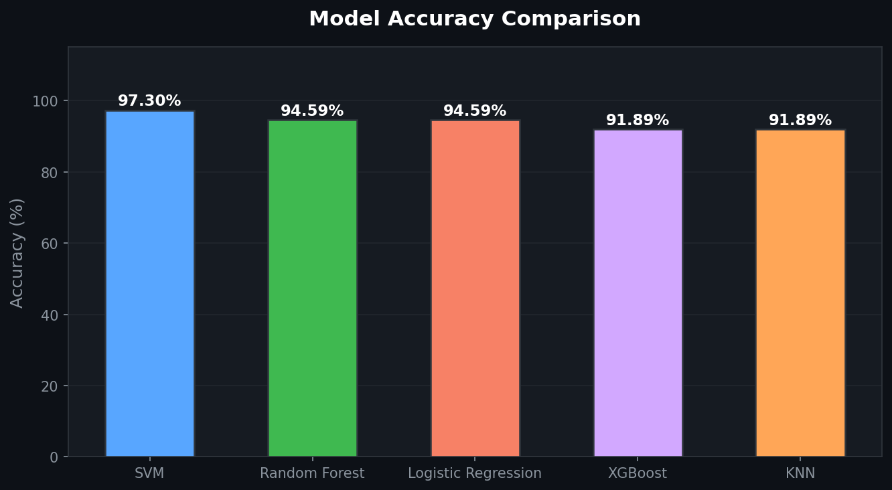
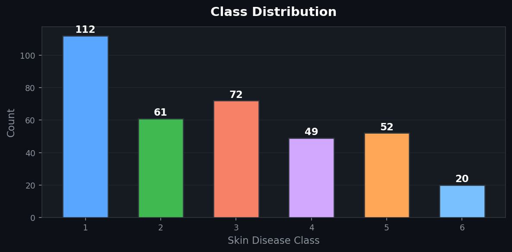
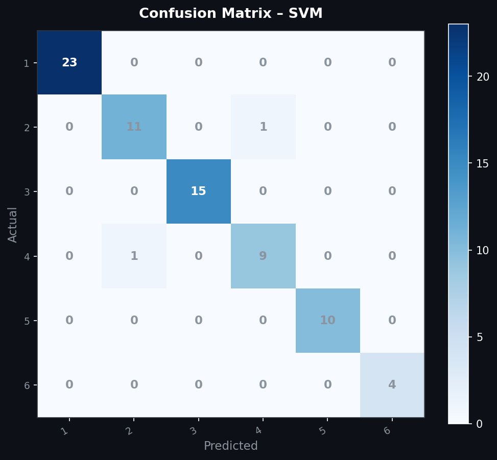
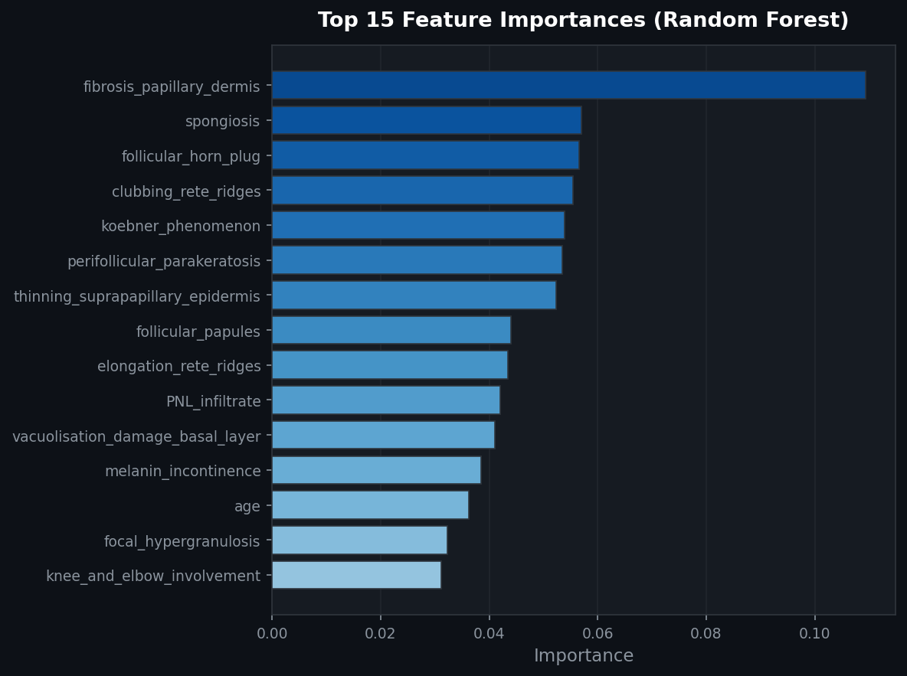

# 🩺 Dermatology ML - Klasifikasi Penyakit Kulit

Proyek machine learning untuk mengklasifikasikan penyakit kulit (dermatologi) menggunakan beberapa algoritma klasifikasi dan membandingkan performanya.

## 📂 Struktur Proyek

```
dermatology/
├── main.ipynb                 # Notebook utama (EDA, preprocessing, modeling, evaluasi)
└── dermatology_database.csv   # Dataset penyakit kulit
```

## 📊 Dataset

Dataset berisi fitur klinis dan histopatologis dari pasien dengan berbagai kondisi kulit, meliputi:
- **Fitur klinis**: erythema, scaling, itching, koebner phenomenon, dan lainnya
- **Fitur histopatologis**: acanthosis, hyperkeratosis, parakeratosis, dan lainnya
- **Target**: 6 kelas penyakit kulit

## 🔧 Alur Kerja

### 1. EDA (Exploratory Data Analysis)
- Analisis tipe data dan missing values
- Eksplorasi distribusi fitur

### 2. Preprocessing
- Imputasi nilai hilang dengan **median** (kolom `age`)
- Encoding fitur kategorikal dengan **LabelEncoder**
- Normalisasi fitur numerik dengan **StandardScaler**
- Train-test split (80:20, stratified)
- Oversampling kelas minoritas dengan **SMOTE**

### 3. Model yang Digunakan

| Model | Keterangan |
|-------|-----------|
| **Random Forest** | 100 estimators, class_weight='balanced' |
| **XGBoost** | multi:softmax, 6 kelas |
| **SVM** | Kernel RBF |
| **KNN** | k=7 neighbors |
| **Logistic Regression** | max_iter=1000 |

### 4. Evaluasi
- Accuracy score per model
- Classification report (precision, recall, F1-score)
- Visualisasi perbandingan akurasi (bar chart)

### 5. Prediksi Data Baru
- Prediksi kelas penyakit kulit untuk sampel data baru menggunakan model yang telah dilatih

## 🛠️ Library yang Digunakan

- `pandas`, `numpy` — manipulasi data
- `matplotlib`, `seaborn` — visualisasi
- `scikit-learn` — preprocessing, modeling, evaluasi
- `xgboost` — gradient boosting
- `imbalanced-learn` — SMOTE oversampling

## 📈 Visualisasi Hasil

### Perbandingan Akurasi Model


### Distribusi Kelas Dataset


### Confusion Matrix (Model Terbaik)


### Feature Importance (Random Forest)


## 🚀 Cara Menjalankan

1. Clone repositori ini:
   ```bash
   git clone https://github.com/Evannnkatanya/dermatology-ml.git
   cd dermatology-ml
   ```

2. Install dependensi:
   ```bash
   pip install pandas numpy matplotlib seaborn scikit-learn xgboost imbalanced-learn
   ```

3. Jalankan notebook:
   ```bash
   jupyter notebook main.ipynb
   ```
